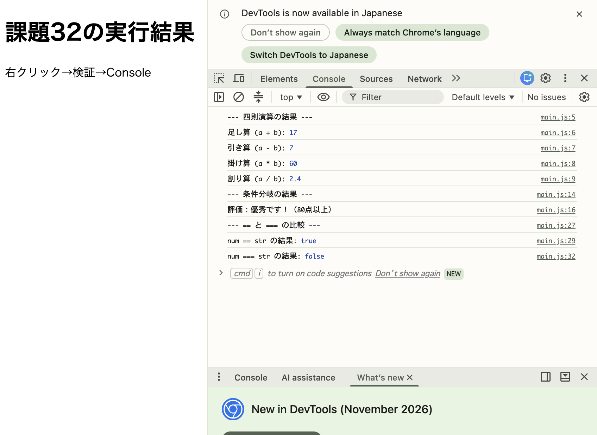

# 32. 基本的な演算と条件分岐
四則演算とif文（またはswitch文）を用いた簡単な処理をmain.js内で実装すること．\
例：2つの変数を比較し，大小を出力するなど
==と===の違いを確認すること．

### main.js
```
// 1. 四則演算の処理
const a = 12;
const b = 5;

console.log("--- 四則演算の結果 ---");
console.log("足し算 (a + b):", a + b);
console.log("引き算 (a - b):", a - b);
console.log("掛け算 (a * b):", a * b);
console.log("割り算 (a / b):", a / b);

// 2. if文による条件分岐の処理
const score = 85;

console.log("--- 条件分岐の結果 ---");
if (score >= 80) {
  console.log("評価：優秀です！（80点以上）");
} else if (score >= 60) {
  console.log("評価：合格です。（60点以上）");
} else {
  console.log("評価：不合格です。");
}

// 3. == と === の違いの確認
const num = 10;       // 数値型
const str = "10";     // 文字列型

console.log("--- == と === の比較 ---");
// == （値だけを比較するため true になる）
console.log("num == str の結果:", num == str);

// === （値と「データ型」の両方を厳密に比較するため false になる）
console.log("num === str の結果:", num === str);
```

### 結果のスクリーンショット

