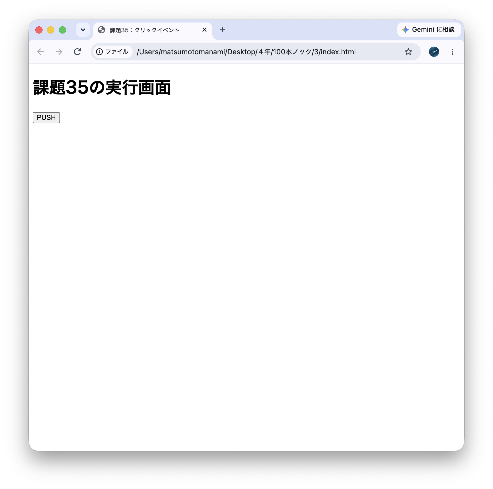
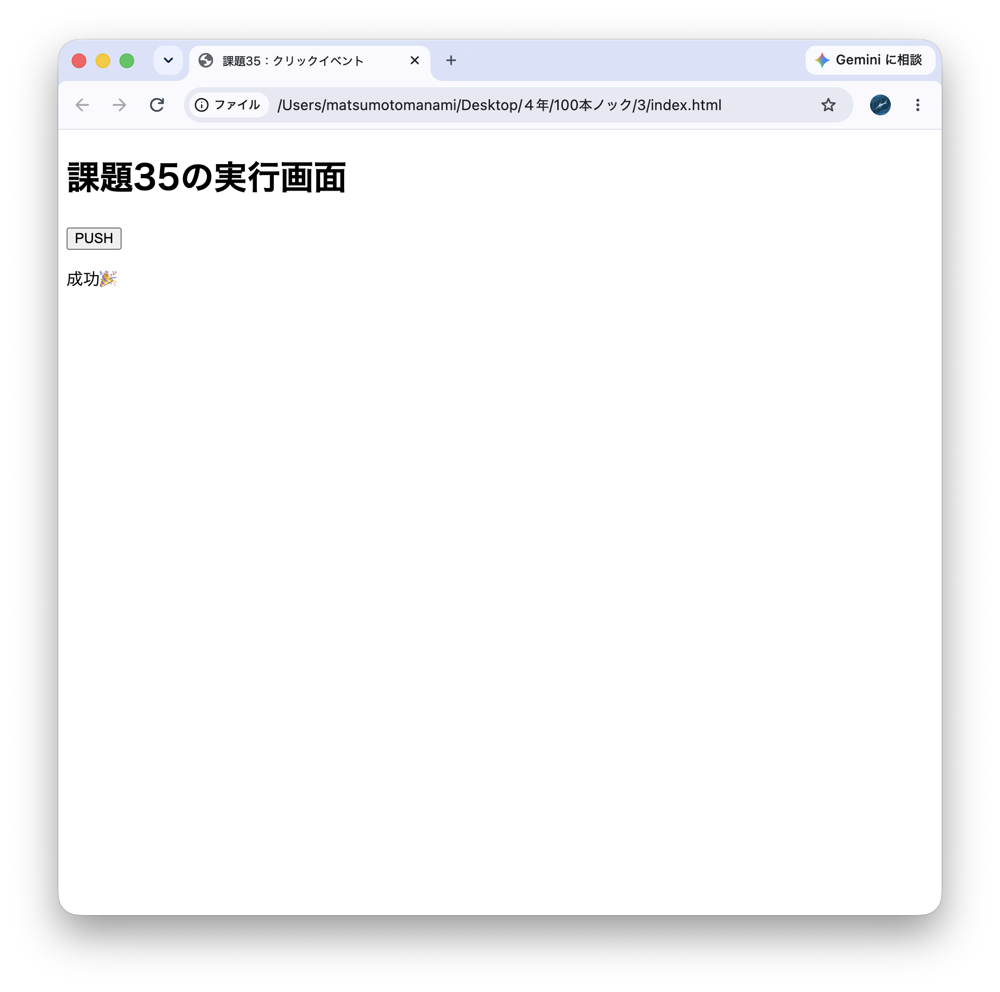
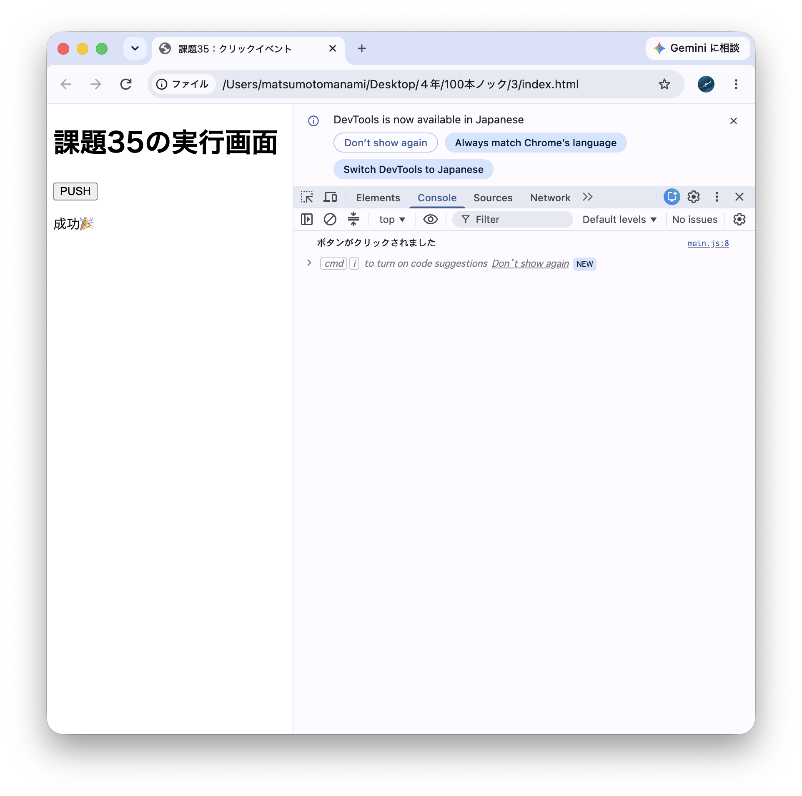

# 35. クリックイベント処理
HTMLにボタンを配置し，JavaScriptでaddEventListenerを用いてイベントリスナーを設定すること．
ボタン押下時にconsole.logやページ上の表示でメッセージを示すこと．

### HTML
```
<!DOCTYPE html>
<html lang="ja">
<head>
  <meta charset="UTF-8">
  <title>課題35：クリックイベント</title>
</head>
<body>
  <h1>課題35の実行画面</h1>
  
  <!-- クリックされるボタン -->
  <button id="my-button">PUSH</button>
  
  <!-- メッセージを表示する場所 -->
  <p id="message"></p>

  <!-- JavaScriptファイルを読み込む -->
  <script src="main.js"></script>
</body>
</html>
```

addEventListener("click", function() { ... })

「イベントリスナーを設定する」というおなじみの書き方です。

「もし指定した要素（ボタン）が 'click'（クリック）されたら、{} の中身の処理をパッと実行してね！」という見張り役・実行役をしてくれます。

message.textContent = "..."

画面上の文字（テキスト）を新しく書き換えるためのプロパティです。

### main.js
```
// 1. HTMLにあるボタンとメッセージ表示用の場所をJavaScriptで見つける
const button = document.querySelector("#my-button");
const message = document.querySelector("#message");

// 2. 「addEventListener」を使って、クリックされたときの動きを設定する
button.addEventListener("click", function() {
  // ① コンソールに文字を出す処理
  console.log("ボタンがクリックされました");

  // ② ページ上の文字（<p>タグ）を書き換える処理
  message.textContent = "成功🎉";
});
```

| `document.querySelector("#my-button")`| HTMLの中にある目印（IDなど）を探して、JavaScriptで操作できるように捕まえてくる命令 |
| `addEventListener("click", function() { ... })` | 「イベントリスナーを設定する」 |
| `message.textContent = "..."` | 画面上の文字（テキスト）を新しく書き換えるためのプロパティ |


### htmlファイルを開くと……


### 「PUSH」を押すと……


